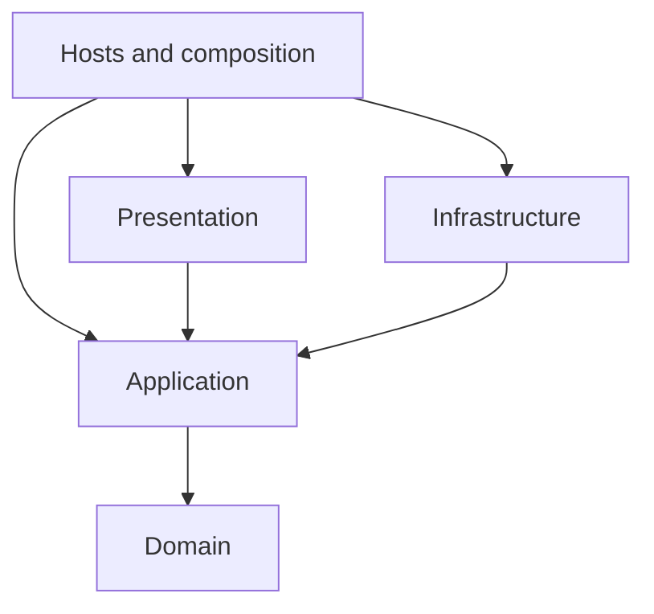
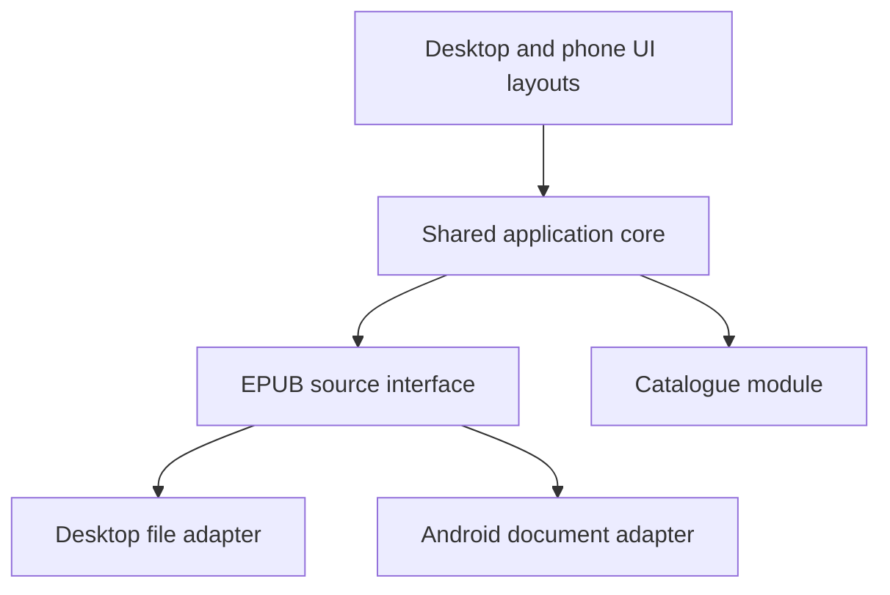

# Cross-platform architecture proposal

Status: architecture outline, updated 2026-11-01. The user chose Avalonia and .NET/C#, basic non-AO3 EPUB support, and Clean Architecture without CQRS. [ADR 0001](../adr/0001-avalonia-and-shared-dotnet-core.md) records the runtime direction, [ADR 0002](../adr/0002-source-independent-work-identity.md) records source-independent work identity, and [ADR 0003](../adr/0003-clean-architecture-without-cqrs.md) records dependency rules and repository layout. Concrete project names and the platform capability proof remain open.

## Goal

Build the Linux MVP while keeping Windows compatibility and a later Android app practical. Reuse collection-management and reading logic, with deliberate desktop and phone layouts. Keep platform integrations replaceable through small interfaces.

## Clean Architecture dependency rules

Code dependencies point inward. Runtime calls can go outward through Application-owned interfaces that outer adapters implement.

| Layer | Responsibility and permitted production dependencies |
|---|---|
| Domain | Work, version, copy, and personal-reading concepts and rules; independent of other production layers and UI/persistence/platform frameworks. |
| Application | Cohesive use-case modules and their input/output contracts; depends on Domain and owns the interfaces it needs from outer adapters. |
| Infrastructure | SQLite catalogue and EPUB extraction implementations, including optional AO3 enrichment; references Application and Domain to implement their contracts. |
| Presentation | Avalonia views and presentation logic; calls Application interfaces and uses inner data contracts without referencing concrete catalogue implementations. |
| Hosts | Desktop and Android startup plus platform-specific adapters; references the required outer implementations and Application to compose the running app. |

The diagram shows the inward direction of code dependencies. Outer implementations may also reference Domain where needed. Host references to concrete adapters are for composition, not a place to implement collection or reading rules.

Expose ordinary methods for catalogue lookups and changes through cohesive Application modules. Use a shared catalogue design and persistence model. CQRS-style command/query handler pipelines and separate read/write stores are outside the chosen architecture. Input and result models remain appropriate where they keep the Application interface clear.

Automated architecture tests must enforce these dependency rules using TUnit. Check production project references and code/type dependencies where feasible, explicitly account for host composition, and reject empty selections. The [testing conventions](../development/testing.md) define the required checks. Testcontainers is reserved for integrations that need a containerized dependency; architecture checks and embedded SQLite tests do not require one.

## Repository layout

The owner requires **`src/` for production projects** and **`tests/` for test projects and committed synthetic fixtures**. Runtime-proof implementation also belongs under `src/`, with its automated checks and fixtures under `tests/`. Planning, specifications, research, and ADRs remain under `docs/`.

Domain, Application, Infrastructure, Presentation, and platform-host responsibilities guide the eventual project layout; concrete project names and assembly counts are not fixed by this outline. Keep the interfaces small and place them at real extraction, persistence, and platform seams.

## Proposed modules

| Module | Responsibility |
|---|---|
| Presentation | Render the collection and work details, collect user actions, and adapt layouts to desktop and phone. |
| Application | Coordinate scanning, import, queries, opening a selected EPUB copy, reading changes, personal ratings, Likes, and notes through a small interface. |
| Domain | Define works, downloaded versions, EPUB copies, duplicate rules, filter semantics, and personal reading information. External source identifiers are optional. |
| EPUB metadata | Hide base EPUB parsing and optional source-specific enrichment behind an extraction interface. Accept EPUB data supplied by the file-source adapter and return available metadata with diagnostics; AO3 preface extraction adds richer source metadata when recognized. |
| Catalogue | Own persistence and query behavior behind its interface. An embedded SQLite implementation is a candidate, subject to runtime and dependency verification. |
| Platform adapters | Supply file/folder selection, enumeration, readable EPUB data, access grants, and the desktop action to open a selected EPUB in the operating system's associated reader. |
| Runner | Start the application and wire the chosen adapters to the shared modules. |

The runner is the host composition root and contains integration and startup logic. Collection and reading rules remain in the shared inner layers. EPUB extraction and catalogue persistence are Infrastructure implementations of Application-owned interfaces. An interface alone cannot make a desktop-only runtime or dependency work on Android; the shared implementation must also be supported there.

## Runtime call flow

Arrows show runtime calls. The runner selects the concrete adapters; shared modules depend on interfaces rather than importing platform implementations.

## Place adapters where behavior varies

Desktop file access can use filesystem paths. Android document access can use permission-granted content/tree URIs. Represent file locations with opaque references at the shared interface and let the adapter resolve them. Keep internal work identity and optional external source identifiers separate from local locations. The platform facts and current plugin limitations are documented in the [runtime research](../research/cross-platform-runtime-options.md).

Share an adapter when its dependency genuinely supports all targets. Introduce separate implementations where behavior differs; avoid creating identical wrappers merely to mirror operating-system names.

The application can run locally on each device. The UI/core separation can use local calls or a runtime bridge; it does not require a hosted backend. Device synchronization remains a later feature, separate from sharing application source code.

External reader launch is a desktop MVP integration. Keep the operating-system launch mechanism outside the shared catalogue and reading logic, and report launch failures to the UI. Opening a copy does not update its reading record; the user records reading explicitly. Android reader integration remains a later decision.

## General EPUB catalogue and source enrichment

Each work has an internal catalogue identity. AO3 work IDs and other external identifiers can assist matching, but are not required for an entry to exist. Source-specific metadata remains optional; personal reading status, notes, ratings, and Likes belong to the general work. Review ambiguous matches without treating every non-AO3 EPUB as unidentified.

The file-source adapter supplies EPUB streams and handles platform access. Within the metadata module, base EPUB extraction supplies available metadata and source-specific extraction can add AO3 categories and publication information. This separates file access, source recognition, and catalogue identity without making AO3 a dependency of ordinary import.

Missing optional metadata must remain distinguishable from known values. The [EPUB 3.3 minimum metadata requirements](https://www.w3.org/TR/epub-33/#sec-metadata-elem) do not guarantee word or chapter counts; basic import must accommodate their absence.

## Runtime comparison and selection

- **Avalonia with .NET/C#:** the recommended first candidate to validate now that the user's .NET/C# experience is known. It can keep the shared application/domain implementation in a familiar language. Its storage abstraction already covers Android folder selection, streams, and bookmarks; actual device support and retained access still need verification. Avalonia UI, styling, and adaptive layouts are new framework work unless the user has prior experience with them.
- **React with Tauri 2:** the main alternative when retaining React is the stronger preference. Shared Rust application logic and the React frontend can serve all three targets, with platform integrations behind adapters. Its official dialog plugin currently lacks Android folder picking, so a suitable integration must be proved. This adds Rust learning and potentially a Kotlin adapter.
- **Flutter:** remains a technically viable alternative, but is no longer the default recommendation given existing C# and React experience. It would need a concrete advantage to justify learning Dart and a different UI stack.
- **Browser-only application:** possible, with browser file-access and persistence constraints to validate against the existing-folder workflow. Sharing web UI code does not require choosing browser-only deployment.

The user selected **Avalonia and .NET** from this comparison. The alternatives remain recorded to explain the trade-off. The [skills-based runtime research](../research/runtime-fit-existing-skills.md) records the verified capabilities and limits, including Avalonia support tiers and the distinction between Avalonia and Microsoft's official .NET MAUI targets.

For the Avalonia candidate, keep the shared C# core independent of Avalonia types. A storage adapter translates picked storage items and bookmarks into the source interface and supplies readable EPUB data. The UI and platform entry projects reference the shared implementation; each runner wires the required integrations.

## Evidence needed to validate the selected runtime

The user has confirmed Android 16 as the current phone target. Avalonia's current support matrix lists Android 16/API 36 on ARM64 and x64 as Tier 1. The phone's actual import, retained-access, and persistence workflow still needs a device test. The Linux target is Pop!_OS 24.04. See the [current platform matrix](https://docs.avaloniaui.net/docs/supported-platforms).

Check Pop!_OS directly rather than assuming it inherits Ubuntu's formal support tier. The release and desktop/session details affect the Linux windowing and folder-picker proof. The [skills-based runtime research](../research/runtime-fit-existing-skills.md) records the relevant primary-source findings.

Prove a small import-and-persistence workflow on Linux and Android with the intended dependencies: select a source, read an EPUB, extract its metadata, save a reading change, and reopen the data after restart. On Android, include the document-tree grant and retained-access workflow. Verify Windows build and packaging support separately.

This technical proof is not yet implemented and does not expand the Android MVP scope. The user's explicit runtime choice is recorded in ADR 0001 before the proof; the proof must establish target-platform fitness, and a failure can require revisiting that decision.

## First capability proof

Selected route: Avalonia with a shared C# core. See the [candidate toolchain](../research/validation-toolchain.md) and [execution record](../research/avalonia-proof-execution.md).

| Check | Evidence to collect |
|---|---|
| Shared implementation | Linux and Android entry projects call the same C# metadata/application implementation, with platform/UI types kept outside that core. Include a synthetic generic EPUB without AO3 identity alongside the AO3 extraction case. |
| Linux source access | On Pop!_OS 24.04, launch a minimal window, select a folder, enumerate EPUBs in its subfolders, and read the representative EPUB's metadata through the source adapter. Record the actual display session during this run. |
| Android source access | On Android 16, select an allowed document tree, enumerate it, and pass an EPUB stream to the same shared extraction implementation. |
| Local persistence | Save one reading-status change and one personal note in a local SQLite catalogue, close/reopen the app, and recover the saved values on both platforms. |
| Retained Android access | Save the folder bookmark/grant and verify access after an app restart and a device restart. Distinguish a bookmark object reopening from an actual successful enumeration/read. |
| Windows compatibility | Record a separate Windows build/package check; mark Windows runtime behavior unverified until it has been exercised on Windows. |

Keep this proof focused on import, platform access, and one persisted reading record. The full collection UI, filters, ratings, synchronization, and reader remain outside the proof. Use the private representative EPUB locally and synthetic metadata fixtures in the repository.

Record exact package/SDK versions and observed results. Failures in Linux rendering, file picking, Android retained access, or native SQLite assets must be assessed before building the MVP on this foundation; revise ADR 0001 if a failure changes the selected direction.
