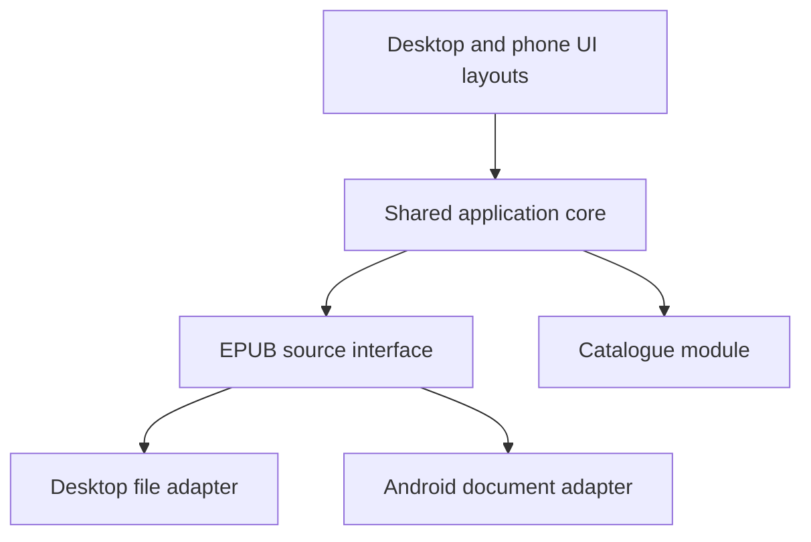

# Cross-platform architecture proposal

Status: proposed on 2026-10-31. The user has confirmed the future Android collection-management goal and suggested frontend/runner adapters. No runtime, language, or UI framework has been selected.

## Goal

Build the Linux MVP while keeping Windows compatibility and a later Android app practical. Reuse collection-management and reading logic, with deliberate desktop and phone layouts. Keep platform integrations replaceable through small interfaces.

## Proposed modules

| Module | Responsibility |
|---|---|
| Presentation | Render the collection and work details, collect user actions, and adapt layouts to desktop and phone. |
| Application | Coordinate scanning, import, queries, reading changes, personal ratings, Likes, and notes through a small interface. |
| Domain | Define AO3 works, downloaded versions, EPUB copies, duplicate rules, filter semantics, and personal reading information. |
| EPUB metadata | Hide ZIP/package/spine/preface parsing behind an extraction interface. Accept EPUB data supplied by the source adapter and return normalized metadata with diagnostics. |
| Catalogue | Own persistence and query behavior behind its interface. An embedded SQLite implementation is a candidate, subject to runtime and dependency verification. |
| Platform adapters | Supply file/folder selection, enumeration, readable EPUB data, access grants, and other platform integrations actually needed by the app. |
| Runner | Start the application and wire the chosen adapters to the shared modules. |

The runner should contain integration and startup logic. Collection and reading rules remain shared. An interface alone cannot make a desktop-only runtime or dependency work on Android; the shared implementation must also be supported there.

## Runtime call flow

Arrows show runtime calls. The runner selects the concrete adapters; shared modules depend on interfaces rather than importing platform implementations.

## Place adapters where behavior varies

Desktop file access can use filesystem paths. Android document access can use permission-granted content/tree URIs. Represent file locations with opaque references at the shared interface and let the adapter resolve them. Keep AO3 work identity separate from a local location. The platform facts and current plugin limitations are documented in the [runtime research](../research/cross-platform-runtime-options.md).

Share an adapter when its dependency genuinely supports all targets. Introduce separate implementations where behavior differs; avoid creating identical wrappers merely to mirror operating-system names.

The application can run locally on each device. The UI/core separation can use local calls or a runtime bridge; it does not require a hosted backend. Device synchronization remains a later feature, separate from sharing application source code.

## Runtime shortlist

- **Avalonia with .NET/C#:** the recommended first candidate to validate now that the user's .NET/C# experience is known. It can keep the shared application/domain implementation in a familiar language. Its storage abstraction already covers Android folder selection, streams, and bookmarks; actual device support and retained access still need verification. Avalonia UI, styling, and adaptive layouts are new framework work unless the user has prior experience with them.
- **React with Tauri 2:** the main alternative when retaining React is the stronger preference. Shared Rust application logic and the React frontend can serve all three targets, with platform integrations behind adapters. Its official dialog plugin currently lacks Android folder picking, so a suitable integration must be proved. This adds Rust learning and potentially a Kotlin adapter.
- **Flutter:** remains a technically viable alternative, but is no longer the default recommendation given existing C# and React experience. It would need a concrete advantage to justify learning Dart and a different UI stack.
- **Browser-only application:** possible, with browser file-access and persistence constraints to validate against the existing-folder workflow. Sharing web UI code does not require choosing browser-only deployment.

These are conditional recommendations, not an accepted stack decision. The [skills-based runtime research](../research/runtime-fit-existing-skills.md) records the verified capabilities and trade-offs, including Avalonia support tiers and the distinction between Avalonia and Microsoft's official .NET MAUI targets.

For the Avalonia candidate, keep the shared C# core independent of Avalonia types. A storage adapter translates picked storage items and bookmarks into the source interface and supplies readable EPUB data. The UI and platform entry projects reference the shared implementation; each runner wires the required integrations.

## Evidence needed before choosing the runtime

Prove a small import-and-persistence workflow on Linux and Android with the intended dependencies: select a source, read an EPUB, extract its metadata, save a reading change, and reopen the data after restart. On Android, include the document-tree grant and retained-access workflow. Verify Windows build and packaging support separately.

This is a proposed technical proof, not an implemented prototype or an expansion of the Android MVP scope. A final runtime ADR should follow the actual target OS/version checks, capability proof, and the user's decision.
